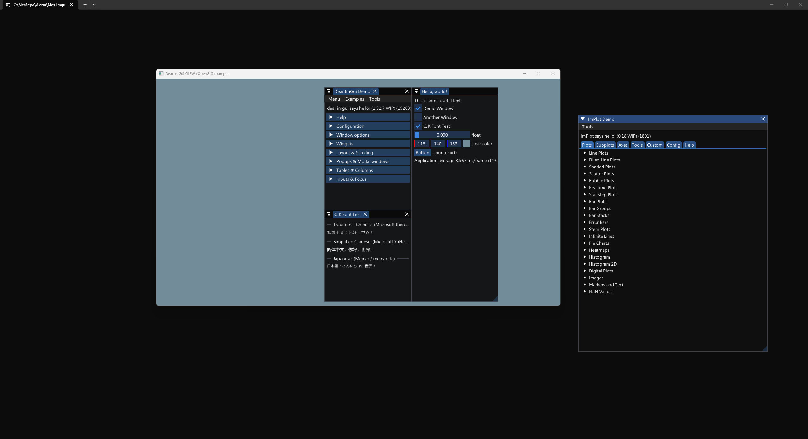

# Mes_Imgui_template

A template project for **Dear ImGui + ImPlot** with the OpenGL 3 + GLFW backend.



## Font setup

The CJK test window needs three fonts copied into `data/`. On Windows you can copy them from `C:\Windows\Fonts\`:

```
data/
  msjh.ttc    # Traditional Chinese  — Microsoft JhengHei (微軟正黑體)
  msyh.ttc    # Simplified Chinese   — Microsoft YaHei    (微软雅黑)
  meiryo.ttc  # Japanese             — Meiryo             (メイリオ)
```

These are proprietary system fonts and are excluded from the repository (`.gitignore`). Font files for other platforms can be substituted by changing the paths in `src/imgui_demo.cpp`.

## How to build

```bash
git clone https://github.com/Mes0903/Mes_Imgui_template.git
cd Mes_Imgui_template
git submodule update --init --recursive

# copy fonts (Windows)
cp C:/Windows/Fonts/msjh.ttc   data/
cp C:/Windows/Fonts/msyh.ttc   data/
cp C:/Windows/Fonts/meiryo.ttc data/

cmake -B build -S .
cmake --build build --config Release
```

The post-build step copies `data/` next to the executable automatically.

## WSL

If you encounter a `wayland-scanner` error, add the following cache variable when configuring:

```bash
cmake -B build -S . -DGLFW_BUILD_WAYLAND=OFF
```

## MinGW

```bash
cmake -B build -S . -G "MinGW Makefiles" \
      -DCMAKE_C_COMPILER=gcc \
      -DCMAKE_CXX_COMPILER=g++
cmake --build build
```

> This didnt be tested, if you encounter any problem, issue is welcome.
